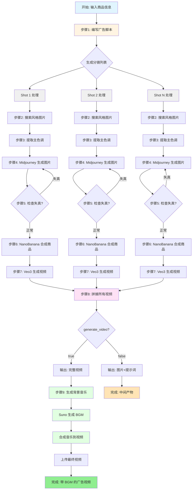

# 广告视频生成工作流程图



## 关键步骤说明

### 并发处理阶段(步骤 2-7)
- 每个分镜(Shot)独立并发处理
- 各自生成独立的视频片段
- 互不干扰,提高效率

### 汇总阶段(步骤 8)
- 收集所有分镜的视频
- 按顺序拼接成完整视频
- 计算总时长

### 音乐合成阶段(步骤 9) 🆕
- LLM 分析广告内容生成音乐提示词
- Suno API 生成符合氛围的背景音乐
- ffmpeg 将音乐合成到视频中
- 自动淡出、音量调节

## 数据流

```
初始输入
├── product_name (商品名称)
├── brand_identity (品牌定位)
├── product_images (商品图片 URL)
└── must_have_shots (必需分镜)

↓

步骤 1 输出
└── shots[] (分镜列表)

↓ (并发)

步骤 2-7 输出(每个 shot)
├── style_image_url (风格图片)
├── palette (主色调)
├── midjourney_image (MJ 图片)
├── nanobanana_image (合成图片)
└── veo3_video (视频) [可选]

↓

步骤 8 输出
├── final_video_url (拼接视频)
└── video_duration (视频时长)

↓

步骤 9 输出
├── music_prompt (音乐提示词)
├── bgm_url (背景音乐)
└── final_video_with_bgm_url (最终视频) ✨
```

## 工具依赖关系

```
LangChain Tools
├── pixelhub
│   ├── list_tags
│   └── search_images_by_tags
├── palette_extractor
│   └── extract_color_palette
├── midjourney
│   ├── midjourney_imagine
│   └── midjourney_upscale
├── distortion_checker
│   └── check_image_distortion
├── nanobanana
│   └── nanobanana_generate
├── veo_video
│   └── veo_generate_video
├── video_concat
│   └── concat_videos
├── suno_music 🆕
│   └── suno_generate_music
└── video_add_bgm 🆕
    └── video_add_bgm_tool
```

## 时间估算

假设生成 3 个分镜的广告:

| 步骤 | 耗时 | 说明 |
|------|------|------|
| 1. 脚本编写 | ~30s | LLM 生成 |
| 2-7. 单个 Shot 处理 | ~5-8min | 并发执行 |
| 8. 视频拼接 | ~30s | ffmpeg 处理 |
| 9. BGM 生成 | ~2-3min | Suno API |
| 9. BGM 合成 | ~30s | ffmpeg 处理 |
| **总计** | **~8-12min** | 含并发优化 |

## 控制标志

### `generate_video`
- `true`: 生成完整视频(包含步骤 9)
- `false`: 只生成图片和提示词(跳过步骤 8-9)

用途:
- 快速预览:设置为 `false`,快速查看图片效果
- 完整生成:设置为 `true`,生成最终可用的广告视频

